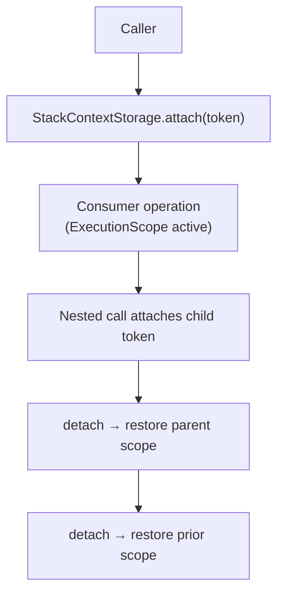
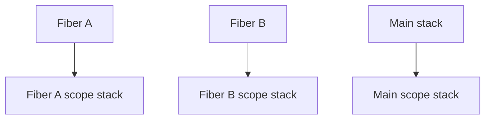
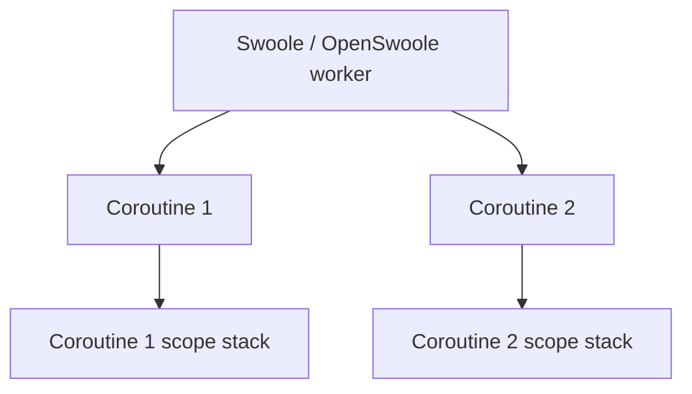

# RunIt Context Propagation

Execution context is the immutable, classified set of values an execution carries.
Propagation is explicit and adapter-backed: the runtime stores the active
execution and its context in a port, and ambient access goes through a small,
deliberately non-global adapter.

## Immutable context

`ExecutionContext` is immutable and copy-on-write: `with()` and `without()`
return changed copies and never mutate the receiver. Every entry is classified
(`public`, `internal`, `confidential`, `restricted`, `secret`) and carries an
optional expiry and source. Classification drives export, propagation, and
serialization independently (see `ContextClassification`). Secret values are
denied everywhere; restricted values are masked on redaction.

Context capacity is bounded (`MAX_ENTRIES`) and merging uses an explicit
`ContextCollisionPolicy` (`Replace`, `Keep`, `Throw`).

## Storage and the ambient scope

The default `StackContextStorage` is a synchronous stack. Attaching a scope
returns a token; detaching it restores the previous nested scope. The storage
rejects invalid tokens and double detachment. Its stack is shared by callers of
the same storage instance, so it does not isolate interleaved Fibers or
coroutines. Persistent workers with overlapping executions must configure
runtime-appropriate storage explicitly.

`CurrentExecution` is the ambient accessor. When no execution is active it
returns `null` (the null-current-execution behavior); it never reads or writes
global mutable state. Swoole/Fiber adapters store the current execution per
coroutine or Fiber and must clear or restore it in `finally`.

## Scope lifetime

The `ExecutionScope` handed to a consumer operation exposes the running
execution, its immutable context, the activity runner, and the measurement,
observation, occurrence, and snapshot recorders. Recorders bind every artifact
to the execution (and to the active activity, when one is running)
automatically, so the consumer never supplies ownership or timing.

The active activity identity changes as activities start and complete; open
activities are tracked so the completion policy can resolve them when the
execution finishes.

## Propagation diagrams

The same immutable context and the same `CurrentExecution` accessor behave
differently per runtime. The diagrams below show how the active execution and its
context are stored and restored in each model.

### Synchronous

A single call stack uses the synchronous `StackContextStorage`. Attaching a scope
pushes a `ContextToken`; detaching pops it and restores the previous nested scope.

### Fiber

When `FiberContextStorage` is configured, it selects a stack by the current
Fiber's identity, with a separate stack for the main call stack. No explicit
context suspend or restore operation is invoked on a Fiber switch.

### Coroutine (Swoole / OpenSwoole)

With `CoroutineContextStorage`, a coroutine ID provider selects the active stack.
The composite storage uses a runtime detector to select the appropriate storage.
The runner detaches scopes in `finally` to restore the prior context.

## Security posture

Propagation must not leak secrets or high-cardinality values. Context,
observations, occurrences, and snapshots are treated as potential exfiltration
paths: classification, redaction, maximum size, cardinality, and serialization
safety are applied before any external publication. Retaining context between
persistent-worker requests is prohibited.

## Vocabulary

- `run-it#ExecutionContext` — the immutable, classified context.
- `run-it#ContextClassification` — the classification vocabulary.

Related decisions: ADR-004 (explicit context propagation is canonical),
ADR-005 (ambient context is adapter-backed), ADR-012 (sensitive values are
deny-by-default). See `docs/EXECUTION.md` and `docs/concepts/context.md`.
