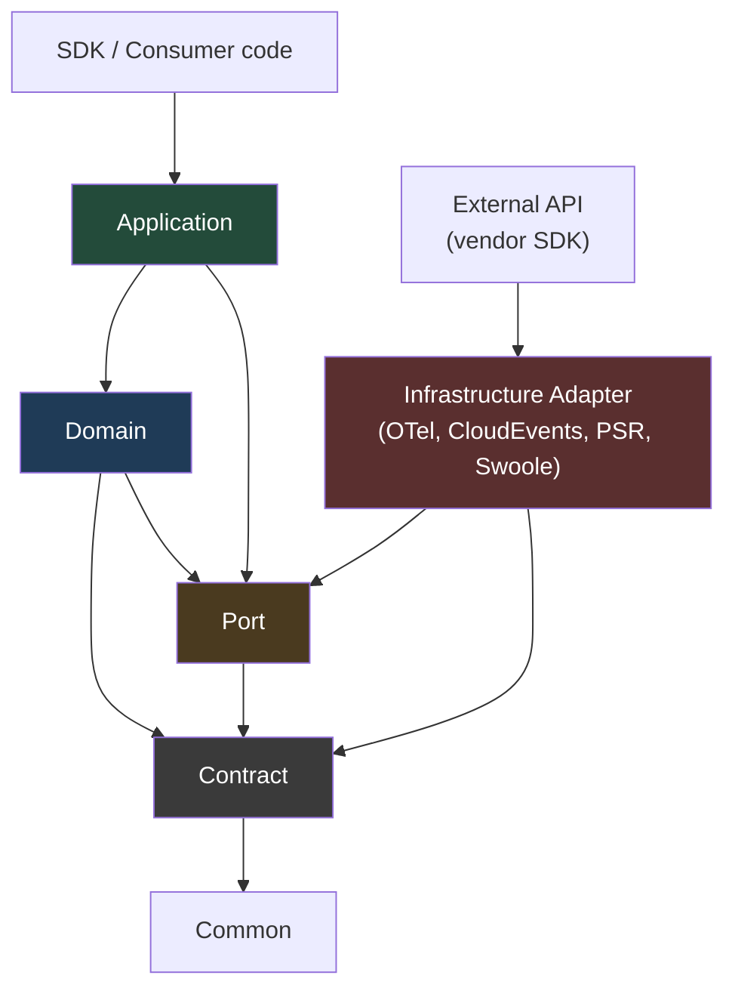

# RunIt Hexagonal Architecture

RunIt is built on hexagonal (ports-and-adapters) architecture. The domain model
is the center; application services orchestrate it; SDK conveniences and external
adapters sit at the edges; and all technology-specific effects cross the boundary
through explicit ports. This keeps the execution model vendor-neutral and lets
OpenTelemetry, CloudEvents, PSR, Swoole, and OpenSwoole be optional adapters rather
than dependencies of the domain.

## Dependency direction

The expected dependency flow points inward:

```text
SDK / Consumer Adapters
          │
          ▼
Application
          │
          ▼
Domain

Infrastructure Adapters ──► Ports ◄── Application
```

In dependency terms:

| Layer | May depend on |
|---|---|
| `Domain` | `Contract` (incl. `Port`), `Common` |
| `Application` | `Contract`, `Port`, `Domain`, `Common` |
| `SDK` | `Contract`, `Port`, `Domain`, `Application`, `Common` |
| `Common Adapter` | `Contract`, `Port`, `Domain`, `Common` |
| `External Adapter` | `Contract`, `Port`, `Domain`, `Common`, external APIs |
| `Contract` | `Common` |
| `Port` | `Contract`, `Common` |
| `Common` | nothing |

## Layered diagram



The full, machine-generated layer graph with edge counts is maintained in
[`dependency-graph.md`](dependency-graph.md) (generated from `deptrac.yaml` via
`vendor/bin/deptrac analyse --formatter=mermaidjs`). `composer architecture`
reproduces the zero-violation report that enforces these edges.

## Ports

Ports are interfaces in `src/Contract/Port` for every external effect:

- `MonotonicClockInterface` — monotonic time for durations (ADR-009).
- `IdentifierGeneratorInterface` — opaque identifier generation (ADR-017).
- `SerializerInterface` — bounded, deterministic (de)serialization.
- `ContextStorageInterface`, `ContextTokenInterface`, `RuntimeContextDetectorInterface`
  — per-call / per-Fiber / per-coroutine context storage.
- `ArtifactPublisherInterface` — the single publication port.
- `SnapshotStoreInterface`, `SnapshotSignerInterface` — snapshot persistence and
  integrity.

Adapters implement ports; the application and domain depend only on the port,
never on a concrete adapter.

## Adapters

- **Common adapters** (`src/Adapter/{Null,Memory,Fiber,Common}`) are
   dependency-free and first-party.
- **External adapters** (`src/Adapter/{OpenTelemetry,CloudEvents,Psr,Swoole}`) hold
  the only reviewed, adapter-confined vendor imports (ADR-006, ADR-010). They are
  never referenced by Domain or Application.

## Consumers and SDK

The SDK (`src/SDK`) offers builders, decorators, and attributes that
compose ports and application services without changing domain semantics. Consumer
code drives the model through the SDK or directly through application services; it
never reaches into the domain for runtime state.

## Boundaries at a glance

- Domain must not depend on Application, SDK, or any adapter.
- Application must not depend on SDK or any adapter.
- External adapters must not be depended on by Domain or Application.

These are DepTrac rules, not optional style. See
[`dependency-graph.md`](dependency-graph.md) for the enforced rules and the
reviewed uncovered edges.

## Vocabulary

- `run-it#Execution` — the domain center; adapters describe it, they do not define
  it.

See [`docs/EXECUTION.md`](../EXECUTION.md), [`docs/concepts/execution.md`](../concepts/execution.md),
and [`docs/QA.md`](../QA.md) for the model and quality gates.
