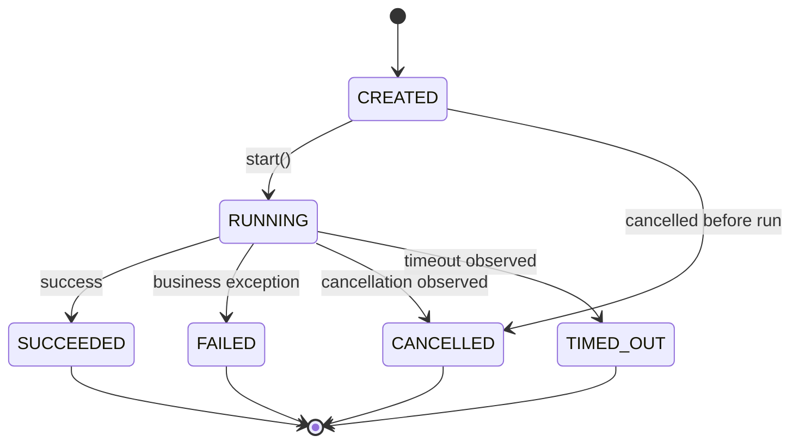
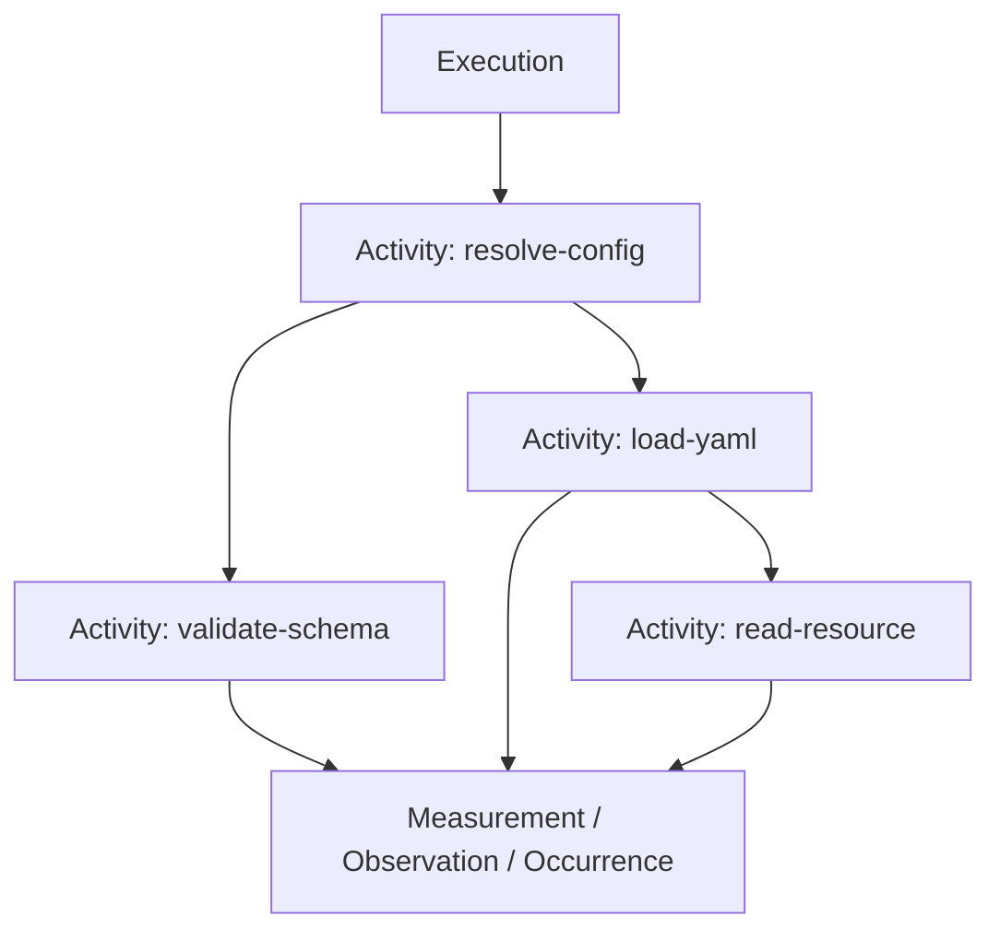

# RunIt Execution Lifecycle

The execution lifecycle is the runtime state machine that governs how an
execution moves from creation to a single terminal outcome. It is implemented in
the application layer and coordinated by `ExecutionLifecycleCoordinator`; the
domain `Execution` record is an immutable artifact that never mutates in place.

## State machine

```text
CREATED
   │
   ▼
RUNNING
   ├──► SUCCEEDED
   ├──► FAILED
   ├──► CANCELLED
   └──► TIMED_OUT
```



A terminal state cannot transition again. Repeating the same terminal completion
is idempotent; a *different* terminal completion raises
`ConflictingCompletionException`.

- `created → running` is performed by the runner through
  `ExecutionLifecycleCoordinator::start()` immediately before the consumer
  operation is invoked. `Execution::create()` produces the `created` record; the
  coordinator transitions it to `running`.
- `created → cancelled` is permitted (a created execution may be cancelled before
  it runs) and is validated by the same transition matrix.
- `running → succeeded | failed | cancelled | timed_out` are the only legal
  terminal transitions.
- A terminal execution cannot transition again. Repeating the same terminal
  completion is idempotent (the coordinator returns the record unchanged), while
  completing a terminal execution with a *different* terminal status raises
  `ConflictingCompletionException`.
- Any other transition raises `InvalidLifecycleTransitionException`.

The closed matrix lives in `ExecutionLifecycleCoordinator::ALLOWED`; the pure
companion `ExecutionLifecycleCoordinator::isAllowed()` reasons about the matrix
without completing an execution.

## Runner flow

`DefaultExecutionRunner::run()` performs the following, always restoring the
prior ambient context in a `finally` block:

1. Resolve the nested-execution policy (`NestedExecutionPolicyInterface`) for the
   current ambient execution and the new definition.
2. Create the `created` execution, then transition it to `running` and publish
   the running execution artifact.
3. Attach the execution scope to the context storage and invoke the consumer
   operation with that scope.
4. On success: resolve open activities, transition `running → succeeded`, and
   publish the completed execution and a terminal `execution` snapshot.
5. On failure: record a failure observation, transition `running → failed`, and
   publish the completed execution and a terminal snapshot.
6. Rethrow the exact original `Throwable`.

Publication failures never replace the business result or exception: the runner
publishes through `FailSafeArtifactPublisher` (configured with the fail-open default
policy), which catches publisher errors and forwards them to the configured health
callback (`onPublicationFailure`).

## Nested execution

Nested calls to the runner are resolved into exactly one
`NestedExecutionMode` (`child_execution`, `activity_only`, `detached_execution`,
`reject_nested`) by the configured policy. The default policy is
`ChildExecutionPolicy`, which links the nested execution to its parent. See
`NestedExecutionPolicyInterface` and the policy implementations in
`Application\Policy`.

## Activity nesting

Activities form an explicit parent/child tree expressed by identity
(`parentActivityId()`), not an in-memory collection. Each nested activity inherits
the active context and reports through the same recorders; open activities are
resolved by the completion policy when the execution finishes. Depth is bounded by
the configured activity-depth limit.



## Exception preservation

A failed execution records the original `Throwable` through
`ThrowableMapperInterface`, which captures only a safe, bounded description
(class, truncated message, optional cause chain, optional stack trace). The
runner always rethrows the exact original `Throwable`; the mapped description is
carried on the failed execution artifact, never in place of the business
exception.

## Cancellation and timeout

Cancellation and timeout are modelled by `Cancellation` and `Timeout` value
objects and mapped through `CancellationMapperInterface` / `TimeoutMapperInterface`.
RunIt records consumer-defined cancellation causes but does **not** forcibly
interrupt arbitrary PHP code: cancellation and timeout are observed and recorded,
not preemptive control-flow mechanisms.

## Vocabulary

- `run-it#Execution` — root aggregate and lifecycle subject.
- `run-it#ExecutionStatus` — the lifecycle status vocabulary.

See `docs/EXECUTION.md` for the canonical execution model and `vocab/run-it.ttl`
for the OWL vocabulary.
