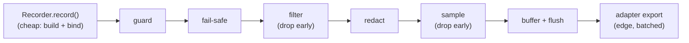

# RunIt Architecture Performance

Execution and activity APIs may run on hot paths, so performance is a design
constraint, not an afterthought. The architecture keeps the steady-state cost of
recording an artifact low and pushes expensive work (mapping, redaction, sampling,
serialization, transport) to the edges. Claims in this document are backed by the
benchmarks under `benchmarks/` and the `composer benchmark` script; no performance
improvement is asserted without measurement.

## Hot-path design rules

| Rule | Where | Why |
|---|---|---|
| Monotonic clocks for duration | `MonotonicClockInterface`, `SystemMonotonicClock` | Wall-clock skew and timezone do not distort durations (ADR-009). |
| Deferred normalization | `NormalizableInterface::normalize()` | Called at publication/serialization time, not on every record. |
| Bounded buffering | `BufferedArtifactPublisher` | Memory never grows without limit under load. |
| Filter before map | `FilteringArtifactPublisher` | Dropped artifacts never reach redaction, sampling, or the adapter. |
| No reflection on hot paths | Domain + Application | Identity, ownership, and timing are resolved by type, not reflection. |
| Reusable immutable mappers | Adapters | One mapper instance per concern; no per-artifact initialization. |
| Sampling before export | `SamplingArtifactPublisher` | High-volume artifacts are dropped before transport. |

## Cost model

Recording an artifact through a recorder is cheap: it builds an immutable value
object, binds it to the active execution/activity scope, and forwards it to the
pipeline. The pipeline's cheap stages (guard, fail-safe, filter) run on every
artifact; the expensive stages (redact, sample, buffer flush, adapter export) are
scoped so volume costs are paid as late as possible.

## Bounded buffers and backpressure

`BufferedArtifactPublisher` is hard-bounded by item count and estimated bytes. Its
`OverflowStrategy` (`DropNewest`, `DropOldest`, `DropLowPriority`, `BlockWithTimeout`,
`Fail`) decides what to drop when full, so a slow adapter cannot exhaust memory.
`flush()` emits at most `batchSize` non-expired artifacts; `close()` flushes within
`shutdownFlushBudget` and reports whatever remains to the health reporter. Dropped
and expired artifacts stay observable without re-entering the guarded pipeline.

## Fiber and coroutine switching

Context is stored per Fiber or per coroutine through `ContextStorageInterface` and
`RuntimeContextDetectorInterface`. Switching cost is the storage lookup plus a
suspend/restore of the active execution, not a deep copy of all artifacts. Retaining
context between persistent-worker requests is prohibited, which also keeps per-request
memory flat. See [`context-propagation.md`](context-propagation.md) for the runtime
diagrams.

## Determinism and hashing

`DeterministicHashCalculator` computes snapshot content hashes over canonical JSON,
so integrity and predecessor linkage do not require retaining every payload. Hashing
is performed at snapshot capture time, not on every read.

## What the architecture avoids

- Network or filesystem operations in core services.
- Reflection during normal execution.
- Eager serialization of artifacts.
- Eager stack-trace generation.
- Retaining all artifacts by default.
- Unbounded recursion, nesting, or buffering.
- Per-artifact initialization of expensive adapters.

## Benchmarked changes

Performance changes require benchmarks when they affect execution start/completion,
activity start/completion, context storage, artifact creation, publication,
serialization, or Fiber/coroutine switching. Run `composer benchmark`; see
[`benchmarks.md`](../benchmarks.md) for the suite and how to interpret results.

## Vocabulary

- `run-it#Execution` — the hot-path subject.

See `AGENTS.md` (Performance Requirements) and [`self-instrumentation.md`](self-instrumentation.md).
