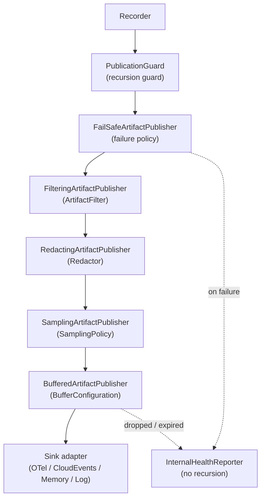

# Artifact Publication Pipeline

RunIt emits immutable artifacts (observations, occurrences, measurements, and snapshots)
through a single port, `ArtifactPublisherInterface::publish(ExecutionArtifactInterface)`.
Adapters decide what "emitting" means: an in-memory buffer, a log line, an OpenTelemetry
export, or nothing. The **publication pipeline** sits between recorders and adapters and
composes small, single-purpose publishers so emission stays secure, bounded, and
failure-aware without coupling the domain to any transport.

The pipeline is built from decorators that all implement `ArtifactPublisherInterface` and
wrap an inner publisher. Because every stage shares the same contract, stages compose in
any order and are independently testable.

## Ordering

The following is the intended ordering, not a guarantee of the SDK builder's
current stack. `PublisherStackFactory::compose()` currently places sampling
outside redaction, so a configured sampling policy receives the original
artifact before the redactor runs. The configurable order and redaction-first
default are pending Phase 2 of `docs/REFACTORING_PLAN.md`.

The intended call flow through the stages is outside-in:

```
guard → fail-safe → filter → redact → sample → buffer → sink
```



| Stage        | Contract / class                                   | Responsibility                                                      |
|--------------|----------------------------------------------------|--------------------------------------------------------------------|
| Guard        | `PublicationGuard`, `GuardedArtifactPublisher`      | Prevents recursive publication on one execution path.               |
| Fail-safe    | `FailSafeArtifactPublisher` + `PublicationFailurePolicyInterface` | Applies the failure policy when the inner publisher throws.  |
| Filter       | `FilteringArtifactPublisher` + `ArtifactFilterInterface` | Drops uninteresting artifacts before any expensive mapping.    |
| Redact       | `RedactingArtifactPublisher` + `RedactorInterface`   | Applies the configured redactor before the sink.                   |
| Sample       | `SamplingArtifactPublisher` + `SamplingPolicyInterface` | Drops artifacts the sampling policy rejects.                    |
| Buffer       | `BufferedArtifactPublisher` + `BufferConfiguration`  | Bounds memory and flushes in batches.                             |
| Sink         | any `ArtifactPublisherInterface` adapter            | The real transport (in-memory, log, OpenTelemetry, ...).          |

Filtering runs first by design: a dropped artifact never reaches redaction, sampling,
buffering, or the adapter, so volume costs are paid as late as possible.

## Redaction happens before external publication

`RedactingArtifactPublisher` forwards the result of `RedactorInterface::redact()`.
The default redactor returns the original instance when nothing matches and a generic
`RedactedArtifact` projection otherwise; it does not mutate the original. Its current
throwable masking only inspects a top-level `throwable`, not the `result.throwable`
of a failed execution. Occurrence data and snapshot payload masking only covers
configured key names, and the default lists are empty. Generic projections can also
miss typed adapter dispatch. These limitations are tracked in Phase 2; do not treat
this pipeline as a complete security boundary for arbitrary artifact contents.

## Failure policies

`FailSafeArtifactPublisher` catches the original adapter exception and hands it to a
`PublicationFailurePolicyInterface`:

- **FailOpenPolicy** — swallows the error (default). Publication must never replace the
  operation's business result or business exception.
- **FailClosedPolicy** — rethrows the *original* adapter error unchanged.
- **CollectAndContinuePolicy** — forwards the error and artifact to a collector.
- **ReportToFallbackPolicy** — republishes the artifact to a separate fallback publisher;
  a fallback failure is caught and routed to the health reporter instead of recursing.

## Buffering and backpressure

`BufferedArtifactPublisher` checks the current item count and estimated bytes before
admission. The estimated-byte limit is not currently a hard bound: an incoming item can
exceed it, including after a blocking wait or a single eviction. Estimates are not actual
process-memory measurements. When the existing buffer is full, the configured
`OverflowStrategy` decides what to drop:

- **DropNewest** — discard the incoming artifact.
- **DropOldest** — discard the oldest buffered artifact to make room.
- **DropLowPriority** — discard a low-priority artifact (high-priority = error observations
  and terminal snapshots win).
- **BlockWithTimeout** — wait briefly for space, then drop newest.
- **Fail** — throw `BufferOverflowException` so the surrounding failure policy decides.

`flush()` emits at most `batchSize` non-expired artifacts; `close()` flushes within
`shutdownFlushBudget` and drops whatever remains. Dropped and expired artifacts are
reported to the internal health reporter so loss stays observable without re-entering the
guarded pipeline.

Current failure-path characterization also shows that integer overflow in byte accounting
can leave an appended item unaccounted, and a throwing health reporter can interrupt an
eviction before the replacement is appended. These observations describe current behavior,
not a recommended configuration or a guarantee of future behavior.

## Recursion prevention

`PublicationGuard` tracks an active-depth counter. `GuardedArtifactPublisher` enters the
guard before publishing and leaves it in a `finally`, so the guard can never be left open
after a failure. If publication is already active when `enter()` is called, the guard
throws `RecursivePublicationException`, which the guarded publisher catches and routes to
the `InternalHealthReporterInterface` (for example `CallbackHealthReporter` or
`ErrorLogHealthReporter`) instead of publishing again. Health reporters must never call
the guarded publisher, so self-observation (an exporter that records its own export) and
fallback reporting can never loop.

## Composition example

```php
use ItPack\RunIt\Application\Publication\ArtifactRedactionConfig;use ItPack\RunIt\Application\Publication\ArtifactTypeFilter;use ItPack\RunIt\Application\Publication\DefaultArtifactRedactor;use ItPack\RunIt\Application\Publication\Policy\FailClosedPolicy;use ItPack\RunIt\Application\Publication\PublicationPipeline;use ItPack\RunIt\Contract\Domain\ObservationSeverity;

$pipeline = (new PublicationPipeline($sink))
    ->filter(new ArtifactTypeFilter([Observation::class]))
    ->redactor(new DefaultArtifactRedactor(new ArtifactRedactionConfig(sensitiveAttributeKeys: ['password'])))
    ->failurePolicy(new FailClosedPolicy())
    ->build();

$pipeline->publish($observation);
```

This keeps every artifact immutable end-to-end, redacts before the adapter, bounds memory,
prevents recursion, and lets the caller choose fail-open or fail-closed without touching
the domain or the adapter.
