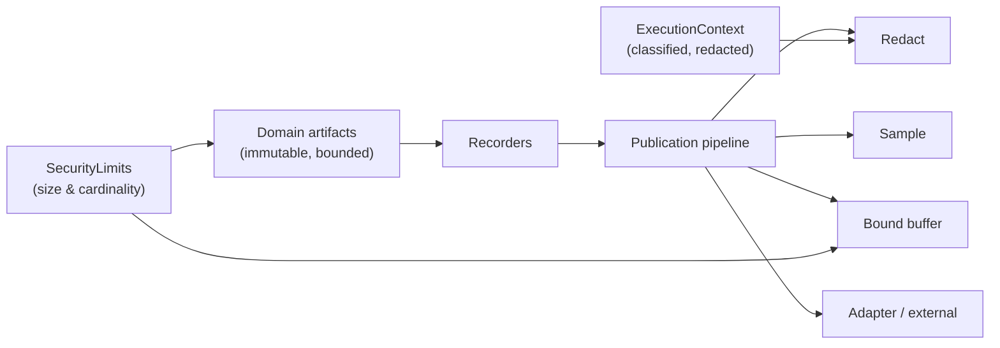

# RunIt Architecture Security

RunIt is a library that models execution; its artifacts (context, observations,
occurrences, snapshots) can carry sensitive runtime data. Security is therefore a
property of the architecture, not an add-on: the design constrains what data can
exist, where it can travel, and what leaves the process. This page covers the
architecture-level controls. The threat model and supply-chain analysis live in
[`../security/threat-model.md`](../security/threat-model.md) and
[`../security/supply-chain.md`](../security/supply-chain.md).

## Defense-in-depth layers

## Classification and redaction (deny-by-default)

Every `ContextEntry` carries a `ContextClassification` (`public`, `internal`,
`confidential`, `restricted`, `secret`). Classification decides the default
export, propagation, and serialization behavior (ADR-012: secret is deny-by-default
everywhere):

| Classification | Export | Propagate | Serialize | On redaction |
|---|---|---|---|---|
| `Public` | yes | yes | yes | kept |
| `Internal` | no | yes | yes | dropped |
| `Confidential` | no | no | yes | dropped |
| `Restricted` | no | no | yes | masked |
| `Secret` | no | no | no | dropped |

Redaction runs **before** any external adapter, inside the publication pipeline
(`RedactingArtifactPublisher` + `RedactorInterface`). The original artifact is
never mutated; the redactor returns a `RedactedArtifact` carrying the redacted
`normalize()` projection when something matches, otherwise the same instance.

## Bounds everywhere (no unbounded exfiltration)

`SecurityLimits` bounds context entry counts, value lengths, array element counts,
attribute depth, and payload sizes. Measurements, observations, occurrences, and
snapshots are all bounded and recursively primitive. Arbitrary PHP object
serialization is prohibited: `normalize()` emits only primitives, and throwables
are projected to a safe `ThrowableDescription`.

## No global mutable execution state

Execution and activity state is never stored in process-global mutable state. The
ambient `CurrentExecution` reads from an explicit `ContextStorageInterface` (a
per-call stack, or per-Fiber / per-coroutine storage in runtime adapters). This
prevents cross-request leakage in persistent workers and keeps the model safe
under Fibers and coroutines (see
[`context-propagation.md`](context-propagation.md)).

## Ports isolate external effects

Every external effect crosses a port (`ArtifactPublisherInterface`,
`SnapshotStoreInterface`, `ContextStorageInterface`, `MonotonicClockInterface`,
`IdentifierGeneratorInterface`, `SerializerInterface`). The domain and application
depend only on the port, so a vendor SDK cannot become a mandatory dependency and
cannot reach into the domain (ADR-006, ADR-010). Core code never configures global
providers or selects an exporter.

## Recursive publication is contained

The publication pipeline is wrapped by `GuardedArtifactPublisher`
(`PublicationGuard`), which throws `RecursivePublicationException` if publication
is already active on the path. That event is routed to
`InternalHealthReporterInterface` (`CallbackHealthReporter`, `ErrorLogHealthReporter`)
rather than back into the guarded publisher, so self-observation and fallback
reporting cannot loop (see [`self-instrumentation.md`](self-instrumentation.md)).

## Fail-open by default, fail-closed available

`FailSafeArtifactPublisher` applies a `PublicationFailurePolicyInterface` when an
adapter throws. The default `FailOpenPolicy` swallows the error so publication
never replaces the business result or business exception. `FailClosedPolicy` and
others are available when the consumer needs strict behavior; a fallback publisher
failure is routed to the health reporter, not re-published.

## Tenant isolation

Context, artifacts, and snapshot stores are partitioned by identity and
classification, not by global state. Snapshot integrity is verifiable via
`SnapshotSignerInterface` and `HashCalculatorInterface`, so a store can detect
tampering without trusting the payload inline. Tests under
`tests/Unit/Application/Security/` assert tenant isolation and redaction behavior.

## What the architecture does NOT do

- It does not perform authentication or authorization; classification is a
  default applied when data leaves the process, not an access-control decision.
- It does not preemptively interrupt PHP code on cancellation or timeout; those are
  observed and recorded (see [`lifecycle.md`](lifecycle.md)).
- It does not export unrestricted execution context.

## Vocabulary

- `run-it#ExecutionContext` — classified, redacted context.
- `run-it#ContextClassification` — the classification vocabulary.

See [`docs/concepts/context.md`](../concepts/context.md),
[`../SECURITY.md`](../SECURITY.md), and `AGENTS.md` (Security Requirements).
