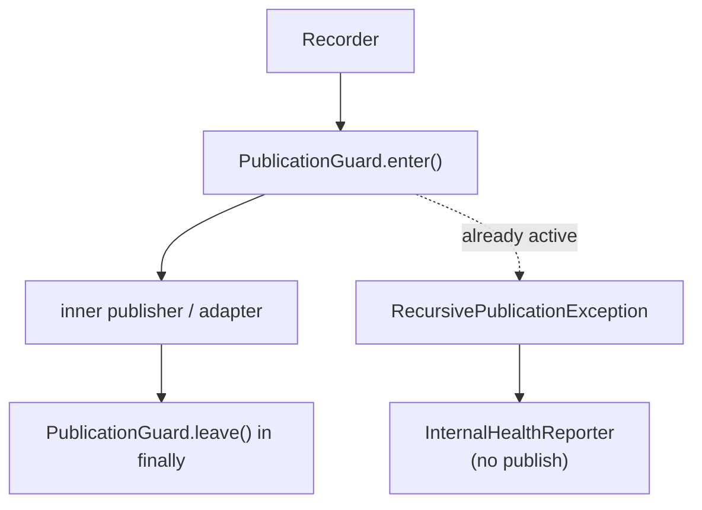

# RunIt Self-Instrumentation

RunIt should use its own execution model to describe its own operation, but it must
never recursively observe the act of publication. This page describes the guard
rails that keep self-instrumentation safe and the intended (uninstrumented) path for
bootstrap and hot code.

## The recursion problem

An adapter exporter is itself an activity that could be recorded as a RunIt
execution. If recording that activity publishes through the same pipeline, the
exporter would observe its own export, which would observe its own observation, and
so on. The same loop appears in fallback reporting: a fallback publisher that fails
must not re-enter the guarded pipeline.

## Recursion guard

`PublicationGuard` tracks an active-depth counter. `GuardedArtifactPublisher`
enters the guard before publishing and leaves it in a `finally`, so the guard can
never be left open after a failure. If publication is already active when `enter()`
is called, the guard throws `RecursivePublicationException`, which the guarded
publisher catches and routes to the `InternalHealthReporterInterface` instead of
publishing again.

Health reporters (`CallbackHealthReporter`, `ErrorLogHealthReporter`) implement
`InternalHealthReporterInterface`. They must never call the guarded publisher, so
self-observation and fallback reporting can never loop.

## Instrument batches, not every method

Instrumentation is applied at the exporter boundary — batches and flushes — rather
than around every internal method. An OpenTelemetry or CloudEvents exporter records
its own export as a single operational activity per batch, not per artifact, which
keeps the self-instrumentation cost flat and avoids re-entering the pipeline on the
hot path.

## Intentionally uninstrumented bootstrap path

The bootstrap and wiring path that builds the engine, the pipeline, and the
publishers is kept uninstrumented on purpose. Constructing the recorder stack must
not itself require a running execution, so there is no circular dependency between
"starting an execution" and "having a publisher". The runner attaches the execution
scope only once the consumer operation is about to run.

## Dogfooding without recursion

When RunIt models its own quality gates (test execution, static analysis,
architecture analysis, mutation testing, benchmarks, release validation — see
M14.6), each is represented as a normal execution through the same ports. The
recursion guard and the health reporter guarantee that representing, say, a
mutation run does not recurse into publication, and that dogfooding does not distort
benchmark timing (the instrumented surface is the batch/flush edge, not the measured
code). See [`lifecycle.md`](lifecycle.md) and [`publication.md`](publication.md).

## What is guarded

- Recursive publication on one execution path → `RecursivePublicationException` →
  health reporter.
- Fallback publisher failure → health reporter, never re-published.
- Self-observation (exporter records its own export) → single batched activity, no
  loop.

## Vocabulary

- `run-it#Execution` — even RunIt's own operation is an execution.

See [`publication.md`](publication.md), [`security.md`](security.md), and `AGENTS.md`
(Self-Instrumentation).
